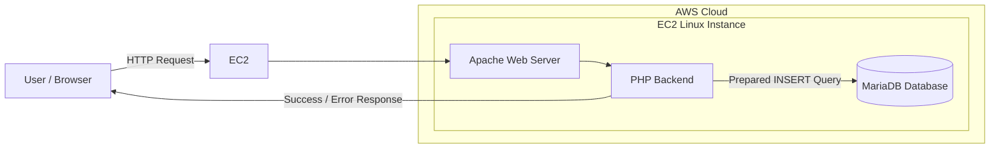
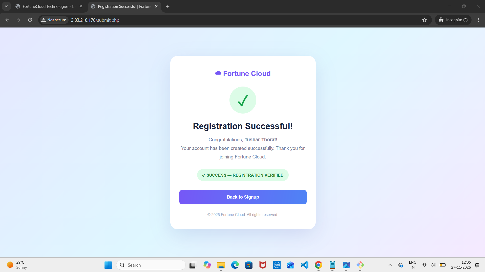

# ☁️ Fortune Cloud – PHP Signup Form with MariaDB on AWS

A modern and responsive **User Registration System** built using HTML, CSS, PHP, and MariaDB, deployed on an AWS EC2 Linux instance using Apache Web Server.

This project allows users to create an account by submitting their personal details through a modern signup form. PHP validates the submitted information, securely hashes the password, and stores the registration data in a MariaDB database.

## 🚀 Project Overview

The Fortune Cloud Signup System demonstrates how to build and deploy a basic web application on AWS EC2.

**Key Features:**

* Modern and responsive signup form UI
* User registration with Full Name, Email, and Phone Number
* Password and Confirm Password validation
* Terms & Privacy Policy acceptance
* Server-side PHP validation
* Secure password hashing using `password_hash()`
* Prepared SQL statements to prevent SQL injection
* MariaDB database integration
* Duplicate email prevention
* Registration success and error messages

## 🛠️ Technology Stack

| Technology           | Purpose              |
| -------------------- | -------------------- |
| AWS EC2              | Cloud hosting        |
| Linux (Amazon Linux) | Operating system     |
| Apache (HTTPD)       | Web server           |
| PHP                  | Backend development  |
| MariaDB              | Database management  |
| HTML5                | Web page structure   |
| CSS3                 | Responsive UI design |
| Git & GitHub         | Version control      |

## 🏗️ Architecture Diagram



## 📋 Signup Form Fields

The registration form collects the following information:

| Field              | Description             |
| ------------------ | ----------------------- |
| Full Name          | User's full name        |
| Email Address      | Valid email address     |
| Phone Number       | Contact number          |
| Password           | Minimum 8 characters    |
| Confirm Password   | Password confirmation   |
| Terms & Conditions | User agreement checkbox |

## 📸 Project Screenshots

### Signup Form



### Registration Success Page


### MariaDB Database Verification


*Add your actual screenshots to the `screenshots/` folder.*

## 🗄️ Database Configuration

**Database Name:** `FCT`

**Table Name:** `user`

### Create Database

```sql
CREATE DATABASE FCT;

USE FCT;
```

### Create User Table

```sql
CREATE TABLE user (
    id INT AUTO_INCREMENT PRIMARY KEY,
    name VARCHAR(100) NOT NULL,
    email VARCHAR(150) NOT NULL UNIQUE,
    phone VARCHAR(20) NOT NULL,
    password VARCHAR(255) NOT NULL,
    created_at TIMESTAMP DEFAULT CURRENT_TIMESTAMP
);
```

## 📂 Project Structure

```text
fortune-cloud-signup/
│
├── index.html
├── submit.php
├── screenshots/
│   ├── signup-form.png
│   ├── success-page.png
│   └── database.png
│
└── README.md
```

## ⚙️ AWS EC2 Deployment

### Step 1: Launch EC2 Instance

* Login to AWS Management Console.
* Launch an Amazon Linux EC2 instance.
* Configure Security Group.
* Allow HTTP (Port 80) access.
* Connect to EC2 using SSH.

### Step 2: Install Required Packages

```bash
sudo yum update -y

sudo yum install -y httpd php php-mysqlnd mariadb-server
```

### Step 3: Start Services

```bash
sudo systemctl enable --now httpd

sudo systemctl enable --now mariadb
```

### Step 4: Configure MariaDB

```bash
sudo mysql
```

Execute:

```sql
CREATE DATABASE FCT;

USE FCT;

CREATE TABLE user (
    id INT AUTO_INCREMENT PRIMARY KEY,
    name VARCHAR(100) NOT NULL,
    email VARCHAR(150) NOT NULL UNIQUE,
    phone VARCHAR(20) NOT NULL,
    password VARCHAR(255) NOT NULL,
    created_at TIMESTAMP DEFAULT CURRENT_TIMESTAMP
);
```

### Step 5: Deploy Project Files

Copy your project files into Apache web root:

```bash
sudo mkdir -p /var/www/html/fortune-cloud

sudo cp index.html submit.php /var/www/html/fortune-cloud/
```

### Step 6: Restart Apache

```bash
sudo systemctl restart httpd
```

### Step 7: Access Website

Open your browser:

```text
http://YOUR-EC2-PUBLIC-IP/fortune-cloud/
```

Your Fortune Cloud signup page should now be accessible.

## 🔐 Security Implementation

* Passwords are stored using PHP `password_hash()`.
* SQL queries use prepared statements.
* Email addresses are validated using PHP.
* Password confirmation is checked before insertion.
* HTML output is escaped using `htmlspecialchars()`.
* Database credentials should be stored securely and not committed to GitHub.
* MariaDB port 3306 should not be exposed publicly.

## 🧪 Database Verification

To verify registered users:

```sql
USE FCT;

DESC user;

SELECT id, name, email, phone, created_at
FROM user;
```

Passwords are stored as hashes and are not displayed in the verification query.

## 📤 GitHub Deployment

Initialize Git:

```bash
git init

git add .

git commit -m "Initial Fortune Cloud signup project"

git branch -M main

git remote add origin YOUR-GITHUB-REPOSITORY-URL

git push -u origin main
```

## 🎯 Learning Outcomes

Through this project, I gained practical experience in:

* Deploying applications on AWS EC2.
* Configuring Apache Web Server.
* Installing and configuring PHP.
* Managing MariaDB databases.
* Connecting PHP applications with MariaDB.
* Implementing secure user registration.
* Using prepared statements and password hashing.
* Managing source code using Git and GitHub.

## 🔮 Future Improvements

* Implement user login and logout functionality.
* Add email OTP verification.
* Add password reset functionality.
* Implement HTTPS using SSL/TLS certificates.
* Move database to AWS RDS.
* Configure CI/CD using GitHub Actions.
* Add AWS CloudWatch monitoring.
* Deploy using a custom domain name.

## 👨‍💻 Author

**Tushar Thorat**

Cloud / DevOps Engineer

**Project:** Fortune Cloud – User Registration System

---

⭐ If you find this project useful, feel free to star the repository!
