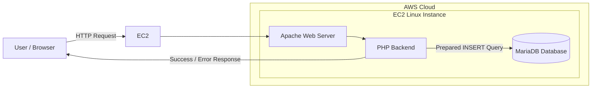
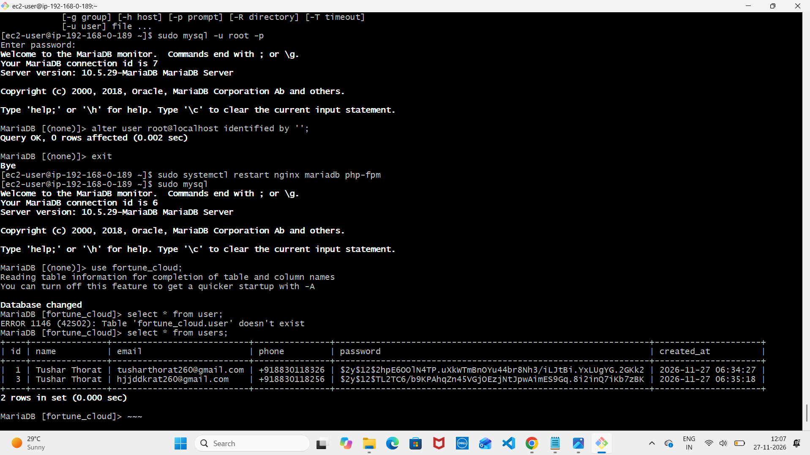

# Task-1


# ☁️ Fortune Cloud – PHP Signup Form with MariaDB on AWS

A modern and responsive **User Registration System** built using HTML, CSS, PHP, and MariaDB, deployed on an AWS EC2 Linux instance using Apache Web Server.

This project allows users to create an account by submitting their personal details through a modern signup form. PHP validates the submitted information, securely hashes the password, and stores the registration data in a MariaDB database.

## 🚀 Project Overview

The Fortune Cloud Signup System demonstrates how to build and deploy a basic web application on AWS EC2.

**Key Features:**

* Modern and responsive signup form UI
* User registration with Full Name, Email, and Phone Number
* Password and Confirm Password validation
* Terms & Privacy Policy acceptance
* Server-side PHP validation
* Secure password hashing using `password_hash()`
* Prepared SQL statements to prevent SQL injection
* MariaDB database integration
* Duplicate email prevention
* Registration success and error messages

## 🛠️ Technology Stack

| Technology           | Purpose              |
| -------------------- | -------------------- |
| AWS EC2              | Cloud hosting        |
| Linux (Amazon Linux) | Operating system     |
| Apache (HTTPD)       | Web server           |
| PHP                  | Backend development  |
| MariaDB              | Database management  |
| HTML5                | Web page structure   |
| CSS3                 | Responsive UI design |
| Git & GitHub         | Version control      |

## 🏗️ Architecture Diagram



## 📋 Signup Form Fields

The registration form collects the following information:

| Field              | Description             |
| ------------------ | ----------------------- |
| Full Name          | User's full name        |
| Email Address      | Valid email address     |
| Phone Number       | Contact number          |
| Password           | Minimum 8 characters    |
| Confirm Password   | Password confirmation   |
| Terms & Conditions | User agreement checkbox |

## 📸 Project Screenshots

### Signup Form


### Registration Success Page


### MariaDB Database Verification




## 🗄️ Database Configuration

**Database Name:** `FCT`

**Table Name:** `user`

### Create Database

```sql
CREATE DATABASE FCT;

USE FCT;
```

### Create User Table

```sql
CREATE TABLE user (
    id INT AUTO_INCREMENT PRIMARY KEY,
    name VARCHAR(100) NOT NULL,
    email VARCHAR(150) NOT NULL UNIQUE,
    phone VARCHAR(20) NOT NULL,
    password VARCHAR(255) NOT NULL,
    created_at TIMESTAMP DEFAULT CURRENT_TIMESTAMP
);
```

## 📂 Project Structure

```text
fortune-cloud-signup/
│
├── index.html
├── submit.php
├── screenshots/
│   ├── signup-form.png
│   ├── success-page.png
│   └── database.png
│
└── README.md
```

## ⚙️ AWS EC2 Deployment

### Step 1: Launch EC2 Instance

* Login to AWS Management Console.
* Launch an Amazon Linux EC2 instance.
* Configure Security Group.
* Allow HTTP (Port 80) access.
* Connect to EC2 using SSH.

### Step 2: Install Required Packages

```bash
sudo yum update -y

sudo yum install -y httpd php php-mysqlnd mariadb-server
```

### Step 3: Start Services

```bash
sudo systemctl enable --now httpd

sudo systemctl enable --now mariadb
```

### Step 4: Configure MariaDB

```bash
sudo mysql
```

Execute:

```sql
CREATE DATABASE FCT;

USE FCT;

CREATE TABLE user (
    id INT AUTO_INCREMENT PRIMARY KEY,
    name VARCHAR(100) NOT NULL,
    email VARCHAR(150) NOT NULL UNIQUE,
    phone VARCHAR(20) NOT NULL,
    password VARCHAR(255) NOT NULL,
    created_at TIMESTAMP DEFAULT CURRENT_TIMESTAMP
);
```

### Step 5: Deploy Project Files

Copy your project files into Apache web root:

```bash
sudo mkdir -p /var/www/html/fortune-cloud

sudo cp index.html submit.php /var/www/html/fortune-cloud/
```

### Step 6: Restart Apache

```bash
sudo systemctl restart httpd
```

### Step 7: Access Website

Open your browser:

```text
http://3.83.218.178
```

Your Fortune Cloud signup page should now be accessible.

## 🔐 Security Implementation

* Passwords are stored using PHP `password_hash()`.
* SQL queries use prepared statements.
* Email addresses are validated using PHP.
* Password confirmation is checked before insertion.
* HTML output is escaped using `htmlspecialchars()`.
* Database credentials should be stored securely and not committed to GitHub.
* MariaDB port 3306 should not be exposed publicly.

## 🧪 Database Verification

To verify registered users:

```sql
USE FCT;

DESC user;

SELECT id, name, email, phone, created_at
FROM user;
```

Passwords are stored as hashes and are not displayed in the verification query.

## 📤 GitHub Deployment

Initialize Git:

```bash
git init

git add .

git commit -m "Initial Fortune Cloud signup project"

git branch -M main

git remote add origin YOUR-GITHUB-REPOSITORY-URL

git push -u origin main
```

## 🎯 Learning Outcomes

Through this project, I gained practical experience in:

* Deploying applications on AWS EC2.
* Configuring Apache Web Server.
* Installing and configuring PHP.
* Managing MariaDB databases.
* Connecting PHP applications with MariaDB.
* Implementing secure user registration.
* Using prepared statements and password hashing.
* Managing source code using Git and GitHub.

## 🔮 Future Improvements

* Implement user login and logout functionality.
* Add email OTP verification.
* Add password reset functionality.
* Implement HTTPS using SSL/TLS certificates.
* Move database to AWS RDS.
* Configure CI/CD using GitHub Actions.
* Add AWS CloudWatch monitoring.
* Deploy using a custom domain name.


**Project:** Fortune Cloud – User Registration System

---

# Task-2

# AWS Three-Tier Student Registration Application


## 1. Project Overview

This project demonstrates a student registration web application hosted in an AWS environment. Users can enter student details through a registration form and view saved records on a Students List page.

The supplied screenshots show:
- A browser-based Student Registration Form.
- A Students List page with Edit and Delete links.
- Linux hosts named `proxy-server`, `application`, and `database-server`.
- Nginx service restart on `proxy-server`.
- SSH access between the named Linux hosts.
- A successful MariaDB client connection to an Amazon RDS endpoint.
- The `studentapp` database and the `students` table.

## 2. Architecture Diagram


### Architecture flow

1. The user opens the Student Registration application in a browser.
2. The environment includes a Linux host named `proxy-server`.
3. The terminal screenshot shows Nginx being restarted on `proxy-server`.
4. SSH commands show access from `proxy-server` to `application`, and then to `database-server`.
5. From `database-server`, the MariaDB client connects to an Amazon RDS MariaDB endpoint.
6. The `studentapp` database is selected and the `students` table is queried.

> **Accuracy note:** The screenshots confirm the host names, Nginx command, SSH sessions, RDS MariaDB connection, database name, table name, and browser pages. They do not show the Nginx reverse-proxy configuration, application framework, exact network/subnet layout, security-group rules, or the precise application-to-database connection path. Treat this as a high-level architecture and verify those details against your AWS configuration before presenting them as exact.

## 3. Components Demonstrated

| Component | Purpose / evidence |
|---|---|
| Linux hosts | Shell prompts show `proxy-server`, `application`, and `database-server` |
| Nginx | `sudo systemctl restart nginx` is run on `proxy-server` |
| SSH | Used to access the other Linux hosts |
| Amazon RDS for MariaDB | MariaDB client connects using an RDS endpoint |
| MariaDB client | Used to select the database and query student records |
| Web application | Registration form and Students List pages shown in browser |

## 4. Database Details

The terminal shows these SQL commands:

```sql
USE studentapp;
SELECT * FROM users;
SELECT * FROM students;
```

The `users` query returns an error because that table does not exist in `studentapp`. The `students` query succeeds and returns one row.

### `students` table columns shown

| Column | Example value shown |
|---|---|
| `student_id` | `1` |
| `student_name` | `tushar` |
| `student_addr` | `pune` |
| `student_age` | `20` |
| `student_qual` | `mca` |
| `student_percent` | `100` |
| `student_year_passed` | `2026` |

The MariaDB server version displayed is `11.8.9-MariaDB-log`, managed by Amazon RDS.

**Security:** Never commit database passwords, private SSH keys, or credential-bearing connection strings to GitHub.

## 5. Application Features

### Student Registration Form

The form contains:
- Student Name
- Student Address
- Student Age
- Student Qualification
- Student Percentage
- Year Passed
- Register button

### Students List

The list page displays:
- Student ID
- Student Name
- Student Address
- Student Age
- Student Qualification
- Student Percentage
- Student Year Passed
- Edit and Delete links

The screenshot shows one saved student record.

## 6. Project Screenshots

### 6.1 Database Connection and SQL Query

Shows SSH access to the Linux hosts, connection to Amazon RDS MariaDB, selection of `studentapp`, and a successful query on `students`.


### 6.2 Student Registration Form

Shows the form used to enter student details.


### 6.3 Students List

Shows a saved student record with Edit and Delete links.


## 7. Validation

| Validation | Screenshot evidence |
|---|---|
| Nginx service command | Restart command run on `proxy-server` |
| SSH access | Login banners shown for the named hosts |
| RDS connectivity | MariaDB monitor welcome message |
| Database selection | `USE studentapp;` succeeds |
| Student data query | `SELECT * FROM students;` returns one row |
| Registration page | Form loads in browser |
| Students list | Record appears with Edit and Delete links |

## 8. Skills Demonstrated

- Linux command-line administration
- Nginx service management
- SSH-based server access
- Amazon RDS MariaDB connectivity
- SQL database selection and querying
- Browser-based application testing
- Understanding of a multi-server cloud application environment

## 9. Conclusion

This project demonstrates a student registration application in an AWS-hosted environment with multiple Linux hosts and an Amazon RDS MariaDB database. Users can enter student information through a registration form and view saved records on a Students List page. The terminal screenshot verifies database connectivity and retrieval of records from the `students` table.


# Task-3


# AWS High Availability Web Application with Application Load Balancer


## Project Overview

This project demonstrates how to host a web application on AWS and make it accessible through an **internet-facing Application Load Balancer (ALB)**. The ALB uses two HTTP listeners to route requests to separate target groups:

- **HTTP :80** → `app-tg` → Welcome website
- **HTTP :8080** → `test-app-tg` → CPU monitoring and load-testing dashboard

The VPC console screenshot shows a VPC with four subnets across two Availability Zones, two route tables, an Internet Gateway connection, and a NAT Gateway connection. The ALB console screenshot shows the load balancer active, both listeners configured, and the registered EC2 target reported as healthy in each target group.

## Project Objectives

1. Build a logically segmented AWS network using a VPC and multiple subnets.
2. Publish web applications through an internet-facing Application Load Balancer.
3. Configure listener-to-target-group routing for two application ports.
4. Verify target health and test the application through the ALB DNS name.
5. Demonstrate a CPU monitoring page and generate test CPU load.

## Architecture Diagram


## AWS Services and Components

| Component | Purpose |
|---|---|
| Amazon VPC | Isolated virtual network for project resources |
| Public subnets | Network subnets intended for internet-facing resources |
| Private subnets | Network subnets intended for internal resources |
| Internet Gateway (IGW) | Provides internet connectivity for resources with suitable public routing |
| NAT Gateway | Allows private-subnet resources to initiate outbound internet access |
| Application Load Balancer | Receives HTTP requests and forwards them to target groups |
| ALB Listener :80 | Routes requests to `app-tg` |
| ALB Listener :8080 | Routes requests to `test-app-tg` |
| EC2 | Hosts the registered application target |
| Target Groups | Define the destinations for listener forwarding and health checks |

## Request Flow

### 1. Welcome Website – Port 80

1. A user opens the ALB DNS name in a browser.
2. The request reaches the ALB on HTTP port `80`.
3. The listener forwards the request to `app-tg`.
4. The target group sends the request to the registered EC2 target.
5. The Fortune Cloud Technologies welcome page is returned to the browser.

**Test URL:**

```text
http://<ALB-DNS-NAME>/
```

### 2. CPU Monitoring Dashboard – Port 8080

1. A user opens the ALB DNS name with port `8080`.
2. The request reaches the ALB listener on port `8080`.
3. The listener forwards the request to `test-app-tg`.
4. The target group sends the request to the registered EC2 target.
5. The CPU dashboard displays CPU usage and provides controls to increase or cancel CPU load.

**Test URL:**

```text
http://application-alb-724886124.us-east-1.elb.amazonaws.com:8080/
```

Replace `<application-alb-724886124.us-east-1.elb.amazonaws.com>` with the DNS name shown in the EC2 → Load Balancers console.

## Implementation Summary

### Network

- Created a VPC named `my-vpc-1`.
- Configured four subnets across two Availability Zones, as shown in the VPC resource map.
- Configured two route tables.
- Connected the network to an Internet Gateway and a NAT Gateway.

### Application Load Balancer

- Created an internet-facing Application Load Balancer named `application-alb`.
- Configured HTTP listeners on ports `80` and `8080`.
- Configured listener forwarding to two target groups:
  - `app-tg`
  - `test-app-tg`

### Target Health

The ALB resource map screenshot shows one registered EC2 target in each target group, and both targets are displayed as **Healthy**. The same EC2 instance ID is visible in both target groups.

## Project Screenshots

### 1. VPC Network Resource Map

Shows the VPC, four subnets, two route tables, and network connections.


### 2. Application Load Balancer Configuration

Shows the active ALB, HTTP listeners on ports 80 and 8080, both target groups, and healthy registered targets.


### 3. CPU Monitoring and Load Testing Dashboard

Shows the CPU usage dashboard with **Increase CPU Load** and **Cancel Load** controls.


### 4. Welcome Website

Shows the deployed Fortune Cloud Technologies project welcome page.


## Testing and Validation

| Test | Expected / observed result |
|---|---|
| Open ALB DNS on port 80 | Welcome website is displayed |
| Open ALB DNS on port 8080 | CPU monitoring dashboard is displayed |
| Check ALB state | Active |
| Check `app-tg` target health | Healthy in screenshot |
| Check `test-app-tg` target health | Healthy in screenshot |
| Use CPU load control | Dashboard provides increase/cancel controls |

## Security Recommendations

- Allow inbound HTTP traffic to the ALB only on the required listener ports (`80` and `8080`) for this demonstration.
- Allow the application target's inbound traffic only from the ALB security group, using the actual application ports.
- Do not expose SSH (`22`) to the entire internet; restrict it to a trusted IP or use AWS Systems Manager Session Manager.
- For a production deployment, use HTTPS with an ACM certificate and an HTTPS listener.
- Avoid storing database passwords, access keys, or other secrets in source code or this README.

## Improvements for a Production-Ready Version

- Deploy application instances across multiple Availability Zones.
- Attach an Auto Scaling Group to the appropriate target group(s).
- Add HTTPS using AWS Certificate Manager.
- Configure CloudWatch alarms for CPU utilization, ALB errors, and unhealthy targets.
- Use Route 53 for a custom domain.
- Store application logs centrally and apply least-privilege IAM roles.

## Challenges and Learning Outcomes

- Practiced VPC networking concepts, including subnets, route tables, IGW, and NAT Gateway.
- Learned how ALB listeners forward traffic to target groups.
- Configured separate application access paths using ports `80` and `8080`.
- Validated target health through the ALB console.
- Tested a live welcome page and a CPU monitoring/load-testing dashboard through the ALB DNS name.

## Conclusion

This project demonstrates an AWS-hosted web application accessed through an internet-facing Application Load Balancer. Separate listeners and target groups provide two application endpoints through one load balancer, while the VPC network is organized across multiple subnets and Availability Zones.

The project provided practical experience with AWS networking, load balancing, EC2 target registration, health checks, and application testing.

---

**Project:** AWS Application Load Balancer Web Hosting  

**Author:** Tushar Thorat


